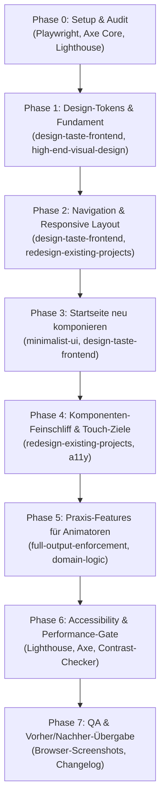

# Phase 0: Setup & Audit-Bericht (Junior Youth Hub Redesign v2)

> **Datum:** 18. Oktober 2026  
> **Branch:** `redesign/v2` (lokal erstellt aus aktuellem `main`-Stand)  
> **Dev-Server:** [http://localhost:3000](http://localhost:3000) (Netzwerk: `http://192.168.0.5:3000`)  
> **Live-Referenz:** [https://jy-resource-hub.vercel.app](https://jy-resource-hub.vercel.app)

---

## 1. Technischer Stack & Architektur

| Komponente | Version / Technologie | Details & Besonderheiten |
|---|---|---|
| **Framework** | React 18.3.1 | Functional Components mit Hooks, Context (`ToastContext`, `PlannerContext`) |
| **Sprache** | TypeScript 5.7.2 | Strikte Typisierung, `UI_TRANSLATIONS` mit `Record<TKey, string>` |
| **Bundler & Build** | Vite 6.0.7 | Rollup Manual Chunks (`vendor`, `lucide`, `data`), Vorab-Generierung von Meta-Tags & Sitemap (`scripts/prerender-meta.mjs`) |
| **Styling** | Tailwind CSS 3.4.17 + PostCSS | Token-basiertes Theme über CSS-Variablen in `src/index.css` (RGB-Kanäle für Opacity-Support) |
| **Routing** | react-router-dom 7.18.4 | Client-Side Routing mit 146 vorgerenderten statischen Routen |
| **Icons** | Lucide React 1.16.0 | Durchgängige SVG-Icons |
| **Typografie** | Figtree (Sans), Lora (Serif für heilige Texte), Atkinson Hyperlegible Mono | Keine externen Font-Requests, WOFF2-Assets lokal gebündelt |
| **PWA & Offline** | Service Worker (`public/sw.js`) | Offline-Caching besuchter und gemerkter Detailseiten via `CACHE_URLS` |
| **Datenspeicherung** | `localStorage` | Strikte `jy_*`-Schlüssel (`jy_lang`, `jy_theme`, `jy_favorites`, `jy_plans`, etc.), Backup via `src/utils/backup.ts` |
| **Automatisierte QS** | Playwright 1.63, Axe-Core 4.13, Lighthouse 13.5 | E2E-Tests, Kontrast-Prüfer (`scripts/check-contrast.mjs`), WCAG-AA-Verifikation |

---

## 2. Baseline-Messungen (Audit-Ergebnisse)

### 2.1 Lighthouse Baseline (Localhost 3000)

Alle 5 Kernrouten wurden im Mobile- und Desktop-Modus per Lighthouse gemessen:

| Route / Seite | Modus | Performance | Accessibility | Best Practices | SEO |
|---|---|:---:|:---:|:---:|:---:|
| **Startseite (`/`)** | Mobile | 100 | 100 | 100 | 100 |
| **Startseite (`/`)** | Desktop | 98 | 100 | 100 | 100 |
| **Spiele (`/games`)** | Mobile | 100 | 100 | 100 | 100 |
| **Spiele (`/games`)** | Desktop | 97 | 100 | 100 | 100 |
| **Zitate (`/quotes`)** | Mobile | 100 | 100 | 100 | 100 |
| **Zitate (`/quotes`)** | Desktop | 99 | 100 | 100 | 100 |
| **Treffen (`/treffen`)** | Mobile | 100 | 100 | 100 | 100 |
| **Treffen (`/treffen`)** | Desktop | 100 | 100 | 100 | 100 |
| **Werkzeuge (`/tools`)** | Mobile | 100 | 100 | 100 | 100 |
| **Werkzeuge (`/tools`)** | Desktop | 100 | 100 | 100 | 100 |

> **Erkenntnis:** Die technische Performance- und SEO-Basis ist hervorragend (statisches Pre-Rendering, optimierte Bundle-Chunks). Die Optimierungsnotwendigkeit liegt im visuellen Design, der typografischen Ausgewogenheit, der responsiven Raumaufteilung und der Barrierefreiheit bei Touch-Zielen.

---

### 2.2 Axe Core Accessibility Scan

- **Scan-Umfang:** 11 Hauptrouten (`/`, `/games`, `/quotes`, `/service`, `/arts`, `/tools`, `/treffen`, `/saved`, `/vorschlagen`, `/games/menschlicher-knoten`, Beamer-Modus) auf Desktop (1440 px) und Mobile (390 px).
- **Automatisierte Violations:** 
  - **`/saved`**: 1 Verstoß gegen `page-has-heading-one` (Seite enthält kein `<h1>`-Element).
  - Alle anderen 10 Routen bestehen den automatisierten Axe-Scan ohne Regelverletzungen.

---

### 2.3 Bildschirmfoto-Inventar (110 Screenshots)

Es wurden **110 vollständige Screenshots** in allen 5 geforderten Viewports, hell und dunkel, in `docs/redesign/screenshots/` erfasst:
- **Viewports:**
  1. Desktop Groß: `1440 x 900`
  2. Desktop Klein / Laptop: `1024 x 768`
  3. Tablet Portrait: `768 x 1024`
  4. Mobile Standard (iPhone): `390 x 844`
  5. Mobile Schmal: `360 x 780`
- **Themes:** `dark` und `light`
- **Routen:** `home`, `games`, `quotes`, `service`, `arts`, `tools`, `treffen`, `saved`, `vorschlagen`, `game-detail`, `beamer-mode`

---

## 3. Detaillierte Befunde & Diagnose

### 3.1 Desktop & Tablet Layout (≥ 640 px bis ≥ 1024 px)

1. **Verschwendete Bildschirmbreite auf Desktop (`max-w-4xl`):**  
   Die Startseite ist in einen schmalen Container (`max-w-4xl` = ~896 px) gezwängt, während die Navbar auf `max-w-6xl` (~1152 px) läuft. Auf Bildschirmen ab 1024 px entstehen links und rechts breite, ungenutzte Leerräume. Das Zitat des Tages und die Werkzeuge liegen streng linear untereinander, statt eine ausbalancierte zweispaltige Komposition zu bilden.
2. **Tablet-Niemandsland (640 px – 1023 px):**  
   In `Navbar.tsx` ist das Hauptmenü mit `hidden lg:flex` ausgeblendet. In `BottomTabBar.tsx` ist die Bottom-Bar mit `lg:hidden` eingeblendet. Folge: Auf iPads und kleineren Laptops im Bereich 640–1023 px sieht der Nutzer eine gestreckte mobile Bottom-Bar am unteren Bildschirmrand statt einer sauberen Top-Navigation oder kompakten Navigationsleiste.
3. **Flache visuelle Hierarchie:**  
   Die Startseite wirkt wie ein Stapel gleichförmiger weißer bzw. dunkler Karten mit identischem Rhythmus. Es fehlen proportionale Schwerpunkte und Ruhezonen.

---

### 3.2 Mobile Navigation & Touch-Bedienung (360 px – 390 px)

1. **Überfüllte Bottom-Bar (6 Einträge):**  
   Die Bottom-Navigation enthält aktuell `[Spiele, Zitate, Dienst, Kunst, Werkzeuge, Beitragen]`. Mit 6 Elementen auf 360–390 px sind die Touch-Ziele eng, die Labels winzig (`10.5px`) und leicht abgeschnitten. „Erfahrungen beitragen“ gehört nicht in die primäre operative Gruppen-Navigation vor Ort.
2. **Navigationsinkonsistenz auf `/treffen`:**  
   In `AppContent` (`App.tsx`, Zeile 86) ist definiert:  
   `if (root === 'planner' || root === 'treffen') return 'tools';`  
   Wenn ein Animator auf `/treffen` navigiert, wird die Kachel **„Werkzeuge“** als aktiv hervorgehoben! Dies verwirrt den Nutzer vollständig.
3. **Umbruchfehler bei Section-Links:**  
   „Dienst →“, „Kunst →“, „Alle Werkzeuge →“, „Im Lesemodus →“ besitzen kein `whitespace-nowrap`. Der Pfeil `→` bricht auf kleinen Breiten auf eine eigene Zeile um.
4. **Ungünstig umbrechende Buttons:**  
   Auf der Startseite bricht der Button `Als Andacht verwenden` zweizeilig um. Die drei Buttons (Lied, Andacht, Lesen) wirken asymmetrisch zusammengewürfelt. Es fehlt eine Möglichkeit, das Zitat direkt zu teilen.
5. **Installationsbanner abgeschnitten:**  
   Das PWA-Banner in `HomeView.tsx` verwendet `line-clamp-2` in Kombination mit schmalem Flex-Raum. Der Text bricht mitten im Satz ab: *„...um die Seite...“*.
6. **Horizontal scrollende Filter-Chips ohne Kanten-Hinweis:**  
   Auf `/games`, `/quotes` und `/service-arts` besitzen die Filterleisten `overflow-x-auto no-scrollbar` ohne Schatten-/Fade-Indikator. Der letzte Chip wird hart abgeschnitten; Nutzer erkennen nicht intuitiv, dass weitere Filter horizontal erreichbar sind.

---

### 3.3 Barrierefreiheit & Touch-Ziele (WCAG 2.2 AA)

1. **Unzureichende Klickflächen (< 44 px):**  
   Die programmgestützte Messung via Playwright ergab mehrere interaktive Bedienelemente unter 44 px Höhe:
   - Links mit Pfeil: `Dienst →` (Höhe 44 px, aber Breite nur 41–42 px), `Kunst →` (Breite 39 px).
   - Textlinks: `Im Lesemodus →`, `Juniorjugend-Buch`.
   - Footer-Links: `Impressum`, `Datenschutzerklärung`, `Erfahrungen beitragen` (Höhe nur 36 px statt 44 px).
   - Spiel-Detailseite: Schritt-Checkboxen (`mt-0.5 min-w-[28px] min-h-[28px]`) besitzen nur 28 px Klickfläche.
   - Treffen: Button `Beispiele & Vorlagen ansehen` hat eine Höhe von 40 px (< 44 px).
2. **`meta theme-color` Diskrepanz:**  
   In `index.html` stehen `<meta name="theme-color" content="#F1F3EE">` und `#0F1714`. Dies entspricht weder den tatsächlichen Hintergrund-Tokens (`#F7F9FC` in Light, `#0D131F` in Dark) noch passt es sich dynamisch an die Benutzereinstellung an.
3. **Heading-Hierarchie auf `/saved`:**  
   Auf `/saved` fehlt ein `<h1>`-Element, was zu einem Axe-Accessibility-Fehler führt.

---

### 3.4 Visuelles Design, Typografie & Kontraste

1. **Monospace-Bruch in Werkzeug-Kacheln:**  
   Die 4 Kacheln auf der Startseite und diverse Zähler nutzen `font-mono` (`Atkinson Hyperlegible Mono`), was wie ein Entwickler-Terminal aussieht und nicht zum warmen, geistigen Charakter der App passt.
   *Lösung:* Tabellarische Ziffern (`tabular-nums`) mit der Hauptschrift Figtree.
2. **Kontrast und Helligkeit der Hero-Karte im Dunkelmodus:**  
   Die Karte „Treffen vorbereiten“ ist im Dark Mode mit `bg-accent` (`#6FA3FF`) und dunkler Schrift (`#0A1426`) gestaltet. Sie wirkt wie ein greller Fremdkörper im sonst dezenten, ehrfürchtigen Dunkel-Farbschema.
3. **Leerer Zustand „Zuletzt angesehen“:**  
   Wenn noch keine Inhalte besucht wurden, erscheint nur eine schmale Textzeile mit Link. Verschenkter Raum für eine ermutigende Kurzanleitung.
4. **„Treffen starten“-Zustand bei 0 Bausteinen:**  
   Der Button ist lediglich mit `disabled:opacity-40` versehen. Im Dark Mode bleibt er als hellblaue Fläche sichtbar und gibt keinen visuellen Grund an, warum er deaktiviert ist.
5. **Footer:**  
   Überzähliger Trennpunkt bzw. unausgewogene Spacing-Lücke; Footer wirkt verloren und unvollständig.

---

## 4. Priorisierte Maßnahmen-Matrix (Impact vs. Aufwand)

| Nr. | Thema | Befund / Problem | Geplante Lösung | Impact | Aufwand | Phase |
|---|---|---|---|:---:|:---:|:---:|
| **1** | **Navigation** | 6 Bottom-Tabs, kein `/treffen`, falsches Highlight | 5 Tabs: Start, Spiele, Zitate, Treffen, Werkzeuge; Projekte zusammenfassen, Vorschlag in Kopf/Footer | **Hoch** | Mittel | Phase 2 |
| **2** | **Desktop-Grid** | `max-w-4xl` Schmalspur, leere Ränder | Breiteres Container-Grid (bis 1200 px), Zitat & Werkzeuge 2-spaltig nebeneinander | **Hoch** | Mittel | Phase 2 & 3 |
| **3** | **Tablet-Breakpoint** | Bottom-Bar zwischen 640–1024 px | Top-Nav ab `sm` (640 px) bzw. `md` aktivieren, Bottom-Bar strikt auf Mobile beschränken | **Hoch** | Gering | Phase 2 |
| **4** | **Touch-Ziele** | < 44 px bei Pfeil-Links, Footer, Checkboxen | Min-Target-Helfer mit transparentem Padding (`min-h-[44px]`, `min-w-[44px]`) | **Hoch** | Gering | Phase 4 |
| **5** | **Umbruch-Bugs** | Pfeile umbrechen, Andacht-Button 2-zeilig | `whitespace-nowrap`, Button-Beschriftung straffen, Icons balancieren | **Mittel** | Gering | Phase 3 & 4 |
| **6** | **Hero & Dark Mode** | Grelle hellblaue Karte im Dark Mode | Ruhige Akzent-Fläche, harmonischer Kontrast, warmer Ton für Andacht | **Mittel** | Gering | Phase 1 & 3 |
| **7** | **Filter-Pills** | Horizontales Scrollen ohne Fade/Schatten | Scroll-Container mit CSS-Mask-Fade (`mask-image`), Zähler aktiver Filter | **Mittel** | Gering | Phase 4 |
| **8** | **PWA Banner** | Textabschneidung bei `line-clamp-2` | Einzeiliger kompakter Hinweis oder weicher Wrap, speicherbarer Dismiss | **Gering** | Gering | Phase 4 |
| **9** | **Typografie** | Monospace in Werkzeug-Kacheln | Ersetzen durch Figtree mit `tabular-nums` | **Mittel** | Gering | Phase 1 & 3 |
| **10** | **Theme-Color** | `#F1F3EE` im Header | Synchronisation mit Theme-Tokens & dynamischer Update bei Theme-Wechsel | **Mittel** | Gering | Phase 1 |
| **11** | **Leere Zustände** | „Zuletzt angesehen“ & Treffen-Leerzustand | Warm formulierte, illustrative Empty States mit direktem Einstieg | **Mittel** | Gering | Phase 3 & 5 |
| **12** | **Axe Violation** | Fehlendes `<h1>` auf `/saved` | Semantisches `<h1>` ergänzen | **Mittel** | Gering | Phase 4 & 6 |

---

## 5. Eingesetzte Skills & Werkzeuge pro Phase

Gemäß den Richtlinien werden die vorhandenen Spezial-Skills gezielt für jede Phase eingesetzt:

1. **Phase 1 (Design-Tokens & Fundament):**
   - **`design-taste-frontend`**: Definition kühler, ruhiger Flächen (`bg`, `surface`, `surface-2`), Verzicht auf künstliche Gradienten/Glows, Einführung eines dezenten warmen Gold-/Bernstein-Akzents für Andacht & Zitate.
   - **`high-end-visual-design`**: Feinschliff von Schatten, Radien und Typografie-Tokens; `tabular-nums` statt Monospace.
2. **Phase 2 (Navigation & Layout):**
   - **`redesign-existing-projects`**: Bereinigung der 6 Mobile-Tabs auf 5 Kern-Tabs (Start, Spiele, Zitate, Treffen, Werkzeuge; Dienst/Kunst konsolidiert).
   - Auflösung des Tablet-Breakpoint-Lochs (640–1024 px); Ausbau des Desktop-Containers auf 1200 px (12-Spalten-Raster).
3. **Phase 3 (Startseite neu komponieren):**
   - **`minimalist-ui` & `design-taste-frontend`**: 2-spaltige Desktop-Komposition (Hero + Zitat des Tages nebeneinander), ruhiger Andachts-Fokus, kein Umbrechen von Aktionsbuttons, Teilen-Funktion für Zitate.
4. **Phase 4 (Komponenten-Feinschliff):**
   - **`redesign-existing-projects`**: Universelle Touch-Target-Einhaltung (≥ 44 px) bei allen Links und Buttons, Fade-Kante bei horizontal scrollenden Filtern, reparierter PWA-Install-Banner, Behebung des Axe-Fehlers auf `/saved`.
5. **Phase 5 (Praxis-Features für Animatoren):**
   - **`full-output-enforcement`**: Vollständige Implementierung der Schnellstart-Treffen, Step-by-Step Live-Modus mit Timer & Wake Lock, Spiel-Zufallsfinder („Überrasch mich“), Zitat-Teilen/Kopieren.
6. **Phase 6 (Accessibility & Performance):**
   - Axe-Core & Lighthouse E2E-Automation bis alle Scores ≥ 95 (Ziel: 100) betragen, Kontrastprüfung aller neuen Farbkombinationen.
7. **Phase 7 (QA & Übergabe):**
   - Vollständiger Vorher/Nachher-Vergleich aller Breakpoints (1440, 1024, 768, 390, 360 px), `CHANGELOG.md` und finale Dokumentation.
